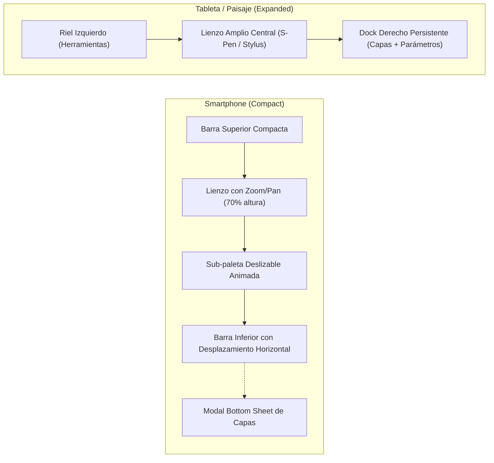

# ChromaCraft Studio 🎨
> Editor gráfico y creativo nativo para Android de alto rendimiento, modular y moderno, inspirado en el análisis de ingeniería inversa de Picsart y construido bajo las directrices visuales de **Material You (Material 3)**.

Desarrollado bajo una arquitectura limpia (**Clean Architecture + MVI**), aceleración gráfica completa por hardware en **Jetpack Compose**, motor de composición gráfica multicapa (**CanvasEngine**), pipeline de sombreado y color **ColorMatrix 4x5**, curvas tonales paramétricas (**ToneCurveEngine**), recorte y máscaras inteligentes (**CutoutEngine**), dibujo con sensibilidad a la presión del stylus y soporte responsivo para **smartphones, tabletas y plegables**.

---

## 🌟 Lenguaje de Diseño e Interfaz (Material You / Material 3)

- **Colores Dinámicos Nativos (Android 12+ / API 31+):** Adaptación cromática instantánea a la paleta del fondo de pantalla del usuario (`dynamicDarkColorScheme` / `dynamicLightColorScheme`) con fallback a un tema oscuro de estudio creativo de alto contraste.
- **Superficies Limpias y Esquinas Orgánicas:** Diseñado con elevación tonal (`surfaceColorAtElevation`), radios amplios (`RoundedCornerShape(16.dp)` a `24.dp`) y jerarquía visual nítida.
- **Animaciones Fluidas y Transiciones:** Uso de `AnimatedVisibility` con deslizamiento vertical y desvanecimiento (`slideInVertically` + `fadeIn`) para paletas contextuales, sin movimientos bruscos.
- **Experiencia Nativa Premium:** Interfaz que aprovecha las APIs de hardware de Android, libre de latencia o patrones de vista web embebida.

---

## 🛠️ Conjunto Completo de Herramientas Implementadas

### 1. Edición Fotográfica Profesional
- **Recorte y Giro:** Relaciones de aspecto estándar (`1:1 Cuadrado`, `4:5 Post Instagram`, `9:16 Story/TikTok`, `16:9 Portada YouTube`, `3:4 Foto` y `Libre`). Rotación en pasos de 90° y enderezado libre.
- **Volteo Especular:** Volteo Horizontal (`Flip H`) y Volteo Vertical (`Flip V`) no destructivo a nivel de capa.
- **Ajustes Cromáticos y Tonales:** Brillo, Contraste, Saturación, Exposición, Sombras, Altas Luces, Temperatura Kelvin y Tinte (Verde/Magenta) en una sola pasada de matriz $4 \times 5$.
- **Curvas de Tono & Niveles:** Evaluación de curvas spline por canal (Master RGB, Rojo, Verde, Azul) y corrección de punto negro, gamma y punto blanco.
- **Filtros Estilísticos (FX):** Original, Vívido, Cálido, Frío, Drama, B&W Monocromo, Sepia Vintage, Cyberpunk, Retro 90s, Duotono e Invertir.
- **Óptica:** Desenfoque Gaussiano ajustable (0 a 40px) y filtro de máscara de enfoque / nitidez (Sharpen).
- **Recorte Inteligente y Eliminación de Fondo:**
  * Herramienta de **Lazo Vectorial Libre**: el usuario traza la silueta sobre el lienzo y extrae el objeto en una capa independiente.
  * **Chroma Key / Eliminación por Color**: cálculo euclidiano de distancia cromática en espacio RGB con atenuación de bordes (*feathering*).

### 2. Edición Multicapa y Máscaras
- **Pila Heterogénea:** Capas de Imagen (Raster), Dibujo a mano alzada, Texto enriquecido y Stickers/Formas geométricas.
- **Máscaras de Capa:** Máscaras alfa no destructivas con soporte para inversión y activación/desactivación en tiempo real.
- **Modos de Fusión PorterDuff:** Normal, Multiplicar (*Multiply*), Trama (*Screen*), Superponer (*Overlay*), Luz Suave (*Soft Light*), Aclarar (*Lighten*), Oscurecer (*Darken*), Sobreexponer Color (*Color Dodge*), Diferencia y Añadir.
- **Control de Pila:** Reordenamiento vertical con arrastre o botones de subida/bajada, opacidad continua ($0\%$ a $100\%$), duplicación y eliminación.
- **Transformación Afín Libre:** Manipulación de posición ($X, Y$), escala ($S_X, S_Y$), rotación ($\theta$) y volteos por capa.

### 3. Dibujo Digital y Stylus
- **Tipologías de Pincel:** Lápiz Fino, Aerógrafo difuso (*Airbrush*), Caligrafía biselada (*Calligraphy*), Rotulador semitransparente (*Marker*) y Spray de partículas.
- **Sensibilidad a la Presión:** Detección de presión analógica mediante `pointerInput` (`historical` y `pressure` de stylus / Samsung S-Pen), modulando dinámicamente el grosor del trazo.
- **Suavizado Bézier Cuadrático:** Interpolación continua de puntos medios para erradicar artefactos angulares poligonales.
- **Navegación en el Lienzo:** Zoom fluido con dos dedos (hasta 8×), desplazamiento (Pan) y doble toque para encajar en pantalla.

### 4. Composición Tipográfica y Formas
- **Texto Enriquecido:** Tamaño de fuente, color, contorno/borde (*stroke*), sombras personalizadas con desplazamiento y fondos tipo pastilla redondeada.
- **Formas Geométricas y Stickers:** Rectángulo, Rectángulo Redondeado, Círculo, Estrella de 5 puntas, Corazón, Hexágono, Medalla, Bocadillo de diálogo, Flechas, Fuego y Rayos.
- **Gizmo de Manipulación Inversa (Picsart):** Manejador multifunción en la esquina inferior derecha que sincroniza distancia euclidiana y ángulo trigonométrico ($\operatorname{atan2}$) para escalar y rotar con un solo dedo.

### 5. Exportación y Proyectos Editables
- **Formatos:** PNG (conservando canal alfa y transparencia), JPEG (con deslizador de compresión 10-100%) y WebP (lossless y lossy).
- **Escala de Resolución:** Media Resolución ($0.5\times$), Resolución Nativa ($1.0\times$) y Ultra HD ($2.0\times$).
- **Fondo Transparente:** Conmutación entre fondo opaco de estudio o tablero de ajedrez transparente.
- **Proyectos Editables (.chroma):** Guardado completo del proyecto en formato JSON con metadatos de todas las capas, transformaciones, textos y curvas para reanudar la edición posteriormente.

---

## 📐 Matriz Adaptativa: Teléfono vs. Tableta



---

## 📁 Arquitectura Modular del Código

```
app/src/main/java/com/chromacraft/studio/
├── MainActivity.kt                      // Entrada Edge-to-Edge, recepción de imágenes compartidas
├── core/
│   ├── graphics/
│   │   ├── CanvasEngine.kt              // Compositor de capas, aceleración GPU y render offscreen
│   │   ├── BrushEngine.kt               // Suavizado Bézier cuadrático, presión de stylus y pinceles
│   │   ├── FilterEngine.kt              // Sombreadores ColorMatrix 4x5 y modos PorterDuff
│   │   ├── ToneCurveEngine.kt           // Curvas tonales spline y corrección de niveles gamma
│   │   ├── CutoutEngine.kt              // Extracción por lazo y chroma key de fondo
│   │   ├── TransformEngine.kt           // Matrices afines, volteo H/V y matemáticas del Gizmo
│   │   ├── HistoryEngine.kt             // Pila Undo/Redo no destructiva con límite FIFO
│   │   └── ExportEngine.kt              // Renderizado alta resolución, MediaStore y Share Intent
│   ├── model/
│   │   ├── Layer.kt                     // Modelos inmutables (ImageLayer, DrawingLayer, TextLayer, StickerLayer)
│   │   ├── ToneCurve.kt                 // Curvas paramétricas RGB y niveles
│   │   ├── ToolType.kt                  // Catálogo de 10 herramientas profesionales
│   │   ├── BlendModeType.kt             // 10 modos de fusión
│   │   ├── CropRatio.kt                 // Ratios de aspecto estándar
│   │   ├── BrushProperties.kt           // Tipos de pincel, tamaños, opacidad y formas
│   │   └── AdjustmentProperties.kt      // Ajustes continuos de luminancia y color
│   └── project/
│       └── ProjectSerializer.kt         // Serialización de proyectos editables (.chroma)
├── ui/
│   ├── adaptive/
│   │   └── AdaptiveEditorLayout.kt      // Conmutador Smartphone vs Tableta con Material 3
│   ├── components/
│   │   ├── EditorCanvas.kt              // Viewport multitáctil, Gizmo Picsart, lazo y presión
│   │   ├── ToolBar.kt                   // Barra inferior y Riel vertical
│   │   ├── SubToolPalette.kt            // Paletas especializadas por herramienta
│   │   ├── LayerManagerPanel.kt         // Inspector de capas, máscaras y opacidades
│   │   ├── ExportDialog.kt              // Diálogo Material 3 de formatos y resolución
│   │   ├── ResizeDialog.kt              // Diálogo de redimensión física del lienzo
│   │   ├── TextEditorModal.kt           // Diálogo de tipografía y formato
│   │   └── TopBar.kt                    // Barra de estado, tamaño, historial y exportación
│   └── theme/
│       ├── Color.kt                     // Paleta de estudio creativo
│       ├── Theme.kt                     // Material You (Dynamic Colors Android 12+)
│       └── Type.kt                      // Tipografías
└── viewmodel/
    ├── EditorIntent.kt                  // Acciones unidireccionales (MVI)
    ├── EditorUiState.kt                 // Estado inmutable completo del editor
    └── EditorViewModel.kt               // Orquestador de lógica de negocio y persistencia
```

---

## 🚀 Cómo Ejecutar y Probar

1. **Android Studio:**
   - Abre la carpeta `/home/hola/Proyectos/elu aplicacion ayuda nose/` en Android Studio (Koala o posterior).
   - Deja sincronizar Gradle. Ejecuta en cualquier emulador de teléfono o tableta con Android 7.0+ (API 24+).
2. **Pruebas Unitarias:**
   - En `app/src/test/java/com/chromacraft/studio/`, ejecuta:
     * `ToneCurveEngineTest`: verificación de curvas lineales, niveles y corrección gamma.
     * `ProjectSerializerTest`: integridad de serialización JSON de proyectos `.chroma`.
     * `FilterEngineTest`, `TransformEngineTest`, `HistoryEngineTest`.
3. **Simulador Web Interactivo:**
   - Abre [chromacraft_live_simulator.html](file:///home/hola/.gemini/antigravity/brain/779302f6-d0b3-4726-b653-f162d174e4c2/chromacraft_live_simulator.html) en tu navegador para interactuar con el motor Canvas, probar los pinceles, curvas, filtros, capas, gizmo y el cambio dinámico entre teléfono y tableta.
